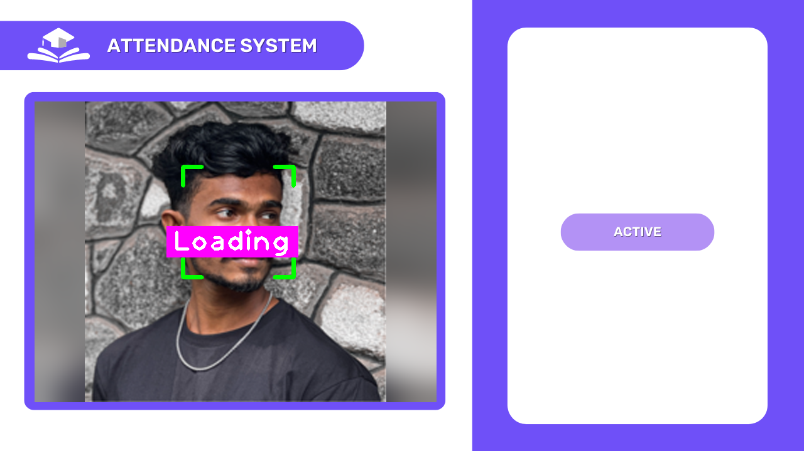

# Attendance System with Face Recognition

A real-time attendance system that recognises employees from a webcam feed, shows their profile on screen, and records attendance in a Firebase Realtime Database.

Stand in front of the camera and the system:

1. detects and identifies your face,
2. pulls your profile (name, role, years of service, total attendance) from Firebase,
3. marks your attendance, and
4. refuses to mark you twice inside the cool-down window.

Built as an academy project with Python, OpenCV, `face_recognition` (dlib) and Firebase.

## Screenshots

| Waiting for a face | Face detected |
|:---:|:---:|
|  |  |

| Employee profile | Attendance marked |
|:---:|:---:|
|  |  |

| Already marked (inside the cool-down) |
|:---:|
|  |

> The screenshots were captured by running the real application against a simulated camera feed, so no live webcam footage is shown.

## How it works

```
webcam frame ──► shrink to 1/4 size ──► detect face + 128-d encoding
                                                │
                       compare with known encodings (EncodeFile.p)
                                                │
                  match ──► Firebase: read Employees/<id>
                                                │
                 last attendance > cool-down? ──► yes: Total_Attendance + 1, save time ──► "Marked"
                                               └─► no : "Already marked"
```

- **`encodeGenerator.py`** reads every photo in `Images/`, computes the face encodings and saves them (with the employee IDs) to `EncodeFile.p`. It can also back the photos up to Firebase Storage, which is optional.
- **`main.py`** runs the live recognition loop. The profile is fetched and attendance written **once per sighting**; the on-screen steps (profile → marked) then advance by wall-clock time, so behaviour doesn't depend on how fast your computer processes frames.
- Employee photos come from the local `Images/` folder, so the app works without Firebase Storage. Storage is only a fallback.
- The UI has four states: **Active** (waiting), **profile** (details), **Marked**, and **Already marked**.

## Tech stack

| Area | Tools |
|---|---|
| Language | Python 3.9 |
| Computer vision | OpenCV, cvzone, NumPy |
| Face recognition | `face_recognition` (dlib) |
| Backend | Firebase Realtime Database (`firebase-admin`); Storage optional |
| Tests | pytest |

## Project structure

```
├── main.py                   # Live camera loop and window
├── attendance.py             # Attendance rules + on-screen state machine
├── recognition.py            # Face detection and matching
├── ui.py                     # Drawing the window
├── store.py                  # Firebase access
├── config.py                 # All settings (Firebase URLs, cool-down, camera, ...)
├── encodeGenerator.py        # Builds EncodeFile.p from Images/
├── AddData.py                # Seeds the Employees records in Firebase
├── TestingUpdateAndAdd.py    # Example of adding / updating a record
├── requirements.txt          # Runtime dependencies (pinned)
├── requirements-dev.txt      # Test tools
├── Images/                   # Employee photos, named by ID (001.png, 002.png, ...)
├── Resources/                # Window background + the four status panels
├── tests/                    # Automated tests
└── docs/screenshots/         # Images used in this README
```

## Getting started

### Prerequisites

- A webcam
- **Python 3.9** (the version this project was developed and tested with)
- A Firebase project (see below)

No C++ compiler or CMake is needed: `requirements.txt` installs a prebuilt `dlib`.

### 1. Clone and install

```bash
git clone https://github.com/NuhaadhHasn/AttendanceSystemWithFaceDetection.git
cd AttendanceSystemWithFaceDetection

python -m venv venv
# Windows:      venv\Scripts\activate
# macOS/Linux:  source venv/bin/activate

pip install --no-deps -r requirements.txt
```

`--no-deps` is intentional: every dependency is pinned in the file, and it stops `face-recognition` from trying to compile `dlib` from source. If there is no prebuilt wheel for your platform, install CMake and a C++ compiler and replace `dlib-bin` with `dlib==19.24.2` in `requirements.txt`.

### 2. Set up Firebase

1. Create a project in the [Firebase console](https://console.firebase.google.com/).
2. Enable **Realtime Database**.
3. Go to **Project settings → Service accounts → Generate new private key** and save the file in the project root as **`serviceAccountKey.json`**.
4. Put your project's database URL in `config.py` (or set the `FIREBASE_DATABASE_URL` environment variable).
5. *(Optional)* Firebase Storage is only used to back up the photos. It requires the *Blaze* (pay-as-you-go) plan; without billing, uploads fail with `403 ... billing account ... is disabled`, which the app tolerates.

> **Never commit `serviceAccountKey.json`.** It gives full admin access to your Firebase project. It is listed in `.gitignore`; keep it that way.

### 3. Add employees

1. Put each face photo in `Images/`, named by employee ID (e.g. `001.png`). Use a clear, front-facing photo. Photos are resized to 216 × 216 px on screen.
2. Add the matching record to the `data` dictionary in `AddData.py`:

   ```python
   "001": {
       "Name": "Jane Doe",
       "Occupation": "Software Engineer",
       "Joined_Year": 2021,
       "Total_Attendance": 0,
       "Last_Attendance_Time": "2023-10-11 18:04:55",
       "Employee_Standard": "G",
       "Total_Working_Years": 2
   }
   ```

3. Write the records to Firebase:

   ```bash
   python AddData.py
   ```

   > `AddData.py` **replaces** each listed record, including its attendance count. To change only some fields of an existing record, use `TestingUpdateAndAdd.py`.

### 4. Generate the face encodings

```bash
python encodeGenerator.py              # encode and back up photos to Storage
python encodeGenerator.py --no-upload  # encode only, no Firebase Storage needed
```

This creates `EncodeFile.p`. Photos with no detectable face are skipped with a warning. Re-run it whenever you add or change a photo.

### 5. Run

```bash
python main.py
```

Look at the camera. The window shows the live feed on the left and the status panel on the right. Press **q** or **Esc** (or close the window) to quit.

## Configuration

Everything lives in `config.py`, and each value can be overridden with an environment variable.

| Setting | Environment variable | Default |
|---|---|---|
| Re-marking cool-down (seconds) | `COOLDOWN_SECONDS` | `30` (demo value; use `86400` for real daily attendance) |
| Camera index | `CAMERA_INDEX` | `0` (first webcam) |
| Face-match strictness | `MATCH_TOLERANCE` | `0.6` (lower is stricter) |
| Firebase database URL | `FIREBASE_DATABASE_URL` | project default |
| Service account key path | `SERVICE_ACCOUNT_KEY` | `serviceAccountKey.json` |

Example (PowerShell): `$env:COOLDOWN_SECONDS = 86400; python main.py`

## Database schema

`Employees/<id>`

| Field | Type | Example |
|---|---|---|
| `Name` | string | `"Jane Doe"` |
| `Occupation` | string | `"Software Engineer"` |
| `Joined_Year` | number | `2021` |
| `Total_Attendance` | number | `50` |
| `Last_Attendance_Time` | string `YYYY-MM-DD HH:MM:SS` | `"2023-10-11 18:04:55"` |
| `Employee_Standard` | string | `"G"` |
| `Total_Working_Years` | number | `2` |

## Tests

```bash
pip install -r requirements-dev.txt
python -m pytest
```

The suite covers the attendance rules (cool-down, once-per-sighting writes, error handling), photo loading, face matching, the encoder, the window drawing, and a full end-to-end run of the real loop using a simulated camera and an in-memory database. No webcam or Firebase connection is needed.

## Troubleshooting

- **`EncodeFile.p not found`** — run `python encodeGenerator.py` first.
- **`Firebase key not found`** — save your service-account key as `serviceAccountKey.json` in the project root (step 2).
- **`Could not open camera`** — check the camera is connected and not in use by another app, or set `CAMERA_INDEX`.
- **`403 ... billing account ... is disabled`** — Firebase Storage needs the Blaze plan. It is optional: encode with `--no-upload` and the app reads photos from `Images/`.
- **`pip install` tries to compile dlib** — use `pip install --no-deps -r requirements.txt` as shown above.
- **`pip check` says `face-recognition requires dlib, which is not installed`** — expected and harmless. The prebuilt package is named `dlib-bin` but provides the same `dlib` module (`python -c "import dlib"` works).

## License

[MIT](LICENSE)

## Author

[@NuhaadhHasn](https://github.com/NuhaadhHasn)
