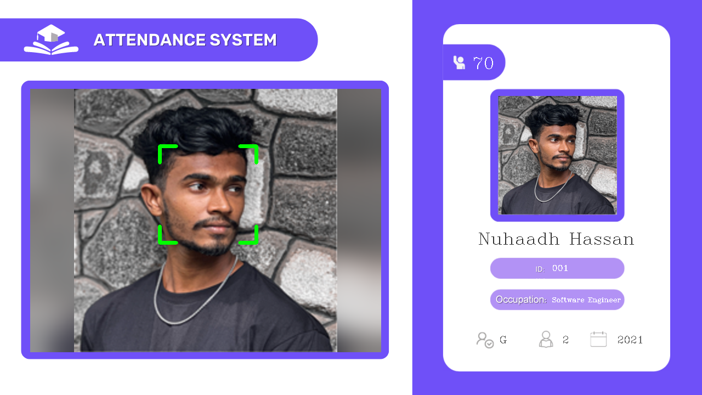
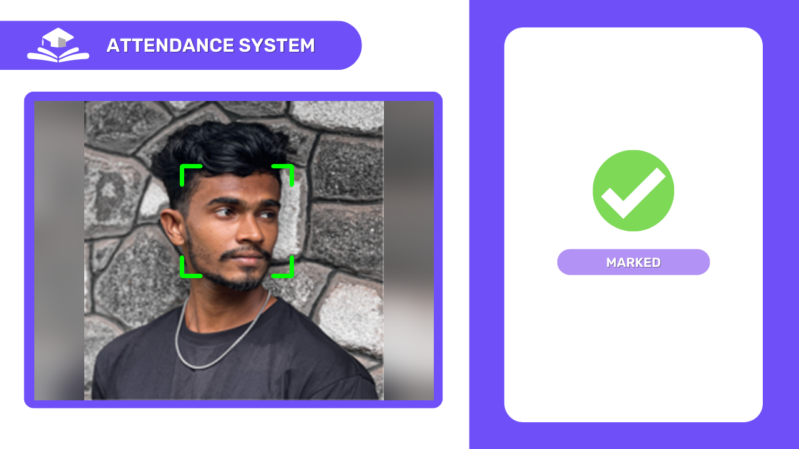

# Attendance System with Face Recognition

A real-time attendance system that recognises employees from a webcam feed, shows their profile on screen, and records attendance in a Firebase Realtime Database.

Stand in front of the camera and the system:

1. detects and identifies your face,
2. pulls your profile (name, role, years of service, total attendance) from Firebase,
3. marks your attendance, and
4. refuses to mark you twice inside the cool-down window.

Built as an academy project with Python, OpenCV, `face_recognition` (dlib) and Firebase.

## Screenshots

| Waiting for a face | Face detected |
|:---:|:---:|
|  |  |

| Employee profile | Attendance marked |
|:---:|:---:|
|  |  |

| Already marked (inside the cool-down) |
|:---:|
|  |

> The screenshots were captured by running the real application against a simulated camera feed, so no live webcam footage is shown.

## How it works

```
webcam frame ──► shrink to 1/4 size ──► detect face + 128-d encoding
                                                │
                       compare with known encodings (EncodeFile.p)
                                                │
                  match ──► Firebase: read Employees/<id>
                                                │
                 last attendance > cool-down? ──► yes: Total_Attendance + 1, save time ──► "Marked"
                                               └─► no : "Already marked"
```

- **`encodeGenerator.py`** reads every photo in `Images/`, uploads it to Firebase Storage, computes the face encodings, and saves them (with the employee IDs) to `EncodeFile.p`.
- **`main.py`** runs the live recognition loop and draws the UI on top of `Resources/background.png` using the four state screens in `Resources/Modes/`.
- The UI has four states: **Active** (waiting), **profile** (details), **Marked**, and **Already marked**.

## Tech stack

| Area | Tools |
|---|---|
| Language | Python 3.9 |
| Computer vision | OpenCV, cvzone, NumPy |
| Face recognition | `face_recognition` (dlib) |
| Backend | Firebase Realtime Database + Firebase Storage (`firebase-admin`) |

## Project structure

```
├── main.py                   # Live recognition + attendance UI
├── encodeGenerator.py        # Builds EncodeFile.p and uploads photos to Storage
├── AddData.py                # Seeds the Employees records in Firebase
├── TestingUpdateAndAdd.py    # Example of adding / updating a record
├── requirements.txt
├── Images/                   # Employee photos, named by ID (001.png, 002.png, ...)
├── Resources/
│   ├── background.png        # Main window layout
│   └── Modes/                # Right-hand panel for each UI state
└── docs/screenshots/         # Images used in this README
```

## Getting started

### Prerequisites

- Windows, macOS or Linux with a webcam
- **Python 3.9** (the version this project was developed and tested with)
- **CMake and a C++ compiler** — `dlib` is compiled during install
  (on Windows install *Visual Studio Build Tools* with the "Desktop development with C++" workload)
- A Firebase project (see below)

### 1. Clone and install

```bash
git clone https://github.com/NuhaadhHasn/AttendanceSystemWithFaceDetection.git
cd AttendanceSystemWithFaceDetection

python -m venv venv
# Windows:  venv\Scripts\activate
# macOS/Linux:  source venv/bin/activate

pip install -r requirements.txt
```

### 2. Set up Firebase

1. Create a project in the [Firebase console](https://console.firebase.google.com/).
2. Enable **Realtime Database** and **Storage**.
   Firebase Storage requires the *Blaze* (pay-as-you-go) plan; without billing enabled, requests fail with `403 ... billing account ... is disabled`.
3. Go to **Project settings → Service accounts → Generate new private key** and save the file in the project root as **`serviceAccountKey.json`**.
4. In `main.py`, `encodeGenerator.py` and `AddData.py`, replace `databaseURL` and `storageBucket` with your own project's values.

> **Never commit `serviceAccountKey.json`.** It gives full admin access to your Firebase project. It is listed in `.gitignore`; keep it that way.

### 3. Add employees

1. Put each face photo in `Images/`, named by employee ID (e.g. `001.png`).
   Photos must be **216 × 216 px** — the profile card has a fixed size.
2. Add the matching record to the `data` dictionary in `AddData.py`:

   ```python
   "001": {
       "Name": "Jane Doe",
       "Occupation": "Software Engineer",
       "Joined_Year": 2021,
       "Total_Attendance": 0,
       "Last_Attendance_Time": "2023-10-11 18:04:55",
       "Employee_Standard": "G",
       "Total_Working_Years": 2
   }
   ```

3. Write the records to Firebase:

   ```bash
   python AddData.py
   ```

### 4. Generate the face encodings

```bash
python encodeGenerator.py
```

This uploads the photos to Storage and creates `EncodeFile.p`. Re-run it whenever you add or change a photo.

### 5. Run

```bash
python main.py
```

Look at the camera. The window shows the live feed on the left and the status panel on the right.

## Configuration

| What | Where | Default |
|---|---|---|
| Re-marking cool-down | `main.py`, `if secondsElapsed > 30` | 30 seconds (demo value; a commented-out line shows the 24-hour production value) |
| Camera index | `main.py`, `cv2.VideoCapture(0)` | first webcam |
| Face-match strictness | `face_recognition.compare_faces(...)` | library default tolerance, 0.6 |

## Database schema

`Employees/<id>`

| Field | Type | Example |
|---|---|---|
| `Name` | string | `"Jane Doe"` |
| `Occupation` | string | `"Software Engineer"` |
| `Joined_Year` | number | `2021` |
| `Total_Attendance` | number | `50` |
| `Last_Attendance_Time` | string `YYYY-MM-DD HH:MM:SS` | `"2023-10-11 18:04:55"` |
| `Employee_Standard` | string | `"G"` |
| `Total_Working_Years` | number | `2` |

## Troubleshooting

- **`dlib` fails to install** — install CMake and the C++ build tools first, then re-run `pip install -r requirements.txt`.
- **`FileNotFoundError: EncodeFile.p`** — run `python encodeGenerator.py` first.
- **`403 ... billing account ... is disabled`** — Firebase Storage needs the Blaze plan.
- **Black or wrong camera** — change the index in `cv2.VideoCapture(0)`.

## Author

[@NuhaadhHasn](https://github.com/NuhaadhHasn)
